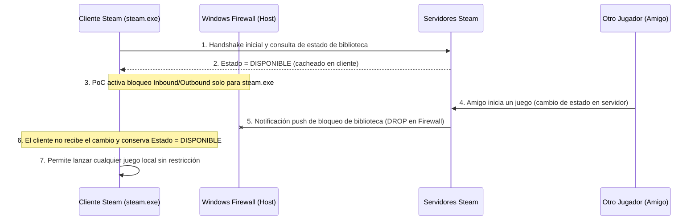

# PoC: Evasión de Validación de Estado en Red y Launcher en C++/WinAPI

[]()
[]()
[]()
[]()

Prueba de concepto (PoC) e investigación de seguridad en entorno local sobre una vulnerabilidad histórica de **desincronización de estado guiada por eventos (*Event-Driven State Validation Bypass*, CWE-840 / CWE-602)** en el antiguo protocolo de verificación de licencias concurrentes de *Steam Family Sharing*, acompañada de un *launcher* en **C++, Qt y WinAPI** para automatizar la manipulación dinámica del firewall del sistema operativo.

> **Nota de contexto histórico:** En 2024 Valve reemplazó el antiguo sistema *Family Sharing* por **Steam Families**, permitiendo de forma nativa jugar simultáneamente a distintos títulos del grupo familiar. Este repositorio se mantiene con fines educativos y de portfolio como demostración de análisis de lógica de negocio en protocolos cliente-servidor, uso de **WinAPI** y automatización de **Windows Firewall**.

---

## 1. Análisis Técnico de la Vulnerabilidad (Cómo funciona)

### Causa raíz: Validación basada en eventos (*Push*) sin *Lease* de expiración (*Fail-Open*)

En el antiguo sistema de préstamo familiar de Steam, una biblioteca completa se bloqueaba para el resto de miembros en el momento en que un usuario iniciaba cualquier juego. Sin embargo, el mecanismo de control presentaba una debilidad arquitectónica en cómo el cliente sincronizaba el estado de los demás jugadores:

1. **Verificación única en el estado inicial:** Al iniciar sesión o abrir el cliente, Steam consultaba una vez el estado de la biblioteca compartida (*«Disponible / Ningún otro jugador activo»*) y almacenaba ese estado como válido en la memoria local del cliente.
2. **Invalidación dependiente de eventos externos:** El cliente **no revalidaba de forma continua y bloqueante** el permiso antes de lanzar un ejecutable local, sino que esperaba recibir una **notificación asíncrona (*push*) desde los servidores de Steam** cuando ocurría un cambio de estado (por ejemplo, cuando un amigo o el propietario entraba a un juego).
3. **Congelación de estado mediante aislamiento selectivo de proceso:** Si, una vez validado el estado inicial (*Disponible*), se cortaba la conectividad de red exclusivamente para el binario `steam.exe` mediante el firewall del sistema operativo (`Inbound` + `Outbound`), el cliente nunca llegaba a recibir el paquete de cambio de estado cuando otro jugador iniciaba una partida. Al operar bajo una lógica *fail-open* sobre su caché local, el cliente permanecía indefinidamente en el estado anterior (*Disponible*), permitiendo iniciar y jugar a cualquier título mientras el resto del sistema operativo conservaba acceso normal a Internet.



---

## 2. Script Standalone de la PoC (`poc/steam_state_bypass_poc.ps1`)

En la carpeta [`poc/steam_state_bypass_poc.ps1`](poc/steam_state_bypass_poc.ps1) se incluye el script autónomo en PowerShell que reproduce el aislamiento selectivo sobre Windows Filtering Platform (WFP) sin necesidad de compilar la interfaz gráfica en C++/Qt:

```powershell
# 1. Crear las reglas de bloqueo Inbound/Outbound para steam.exe (requiere Administrador)
.\poc\steam_state_bypass_poc.ps1 -Mode Install

# 2. Congelar el estado actual de Steam tras la verificación inicial (Aislamiento ON)
.\poc\steam_state_bypass_poc.ps1 -Mode Isolate

# 3. Comprobar el estado actual del aislamiento
.\poc\steam_state_bypass_poc.ps1 -Mode Status

# 4. Restaurar la conexión normal del cliente Steam (Aislamiento OFF)
.\poc\steam_state_bypass_poc.ps1 -Mode Restore

# 5. Eliminar las reglas del sistema
.\poc\steam_state_bypass_poc.ps1 -Mode Remove
```

---

## 3. Implementación en C++, Qt y WinAPI (`launcher/`)

Además del script autónomo, el repositorio incluye una aplicación nativa de escritorio en **C++ y Qt** ([`launcher/launcher.cpp`](launcher/launcher.cpp)) que integra el *bypass* dentro de un lanzador ligero en segundo plano:

* **Manipulación programática de Windows Firewall:**
  * Ejecución asíncrona de `Enable-NetFirewallRule -Displayname offlineSteam` y `Disable-NetFirewallRule -Displayname offlineSteam` solicitando elevación UAC (`-verb runas`) con ventana oculta (`-WindowStyle Hidden`).
  * Verificación en tiempo real del estado de las reglas (`Get-NetFirewallRule`) parseando la salida estándar del subproceso para actualizar el indicador visual de estado (`ON` / `OFF`).
* **Hooks globales de teclado con WinAPI (`User32.dll`):**
  * Registro de *Global Hotkeys* a nivel de sistema operativo mediante `RegisterHotKey( NULL, 1, MOD_CONTROL | MOD_ALT, VK_F12 )` e inspección directa de la cola de mensajes de Windows con `PeekMessage(&msg, NULL, 0, 0, PM_REMOVE)` en un hilo dedicado (`std::thread`) para interceptar `WM_HOTKEY` incluso cuando otra aplicación a pantalla completa tiene el foco.
* **Ejecución desacoplada de procesos:**
  * Lanzamiento de procesos independientes (`QProcess::startDetached`) e integración en bandeja del sistema (`QSystemTrayIcon`).

---

## 4. Mitigación y Lecciones de Diseño Seguro

Desde la perspectiva de **seguridad en el diseño de protocolos y arquitectura de software (AppSec)**, este comportamiento ilustra por qué la seguridad del lado del servidor no puede delegar la vigencia de un estado crítico en notificaciones *push* no confirmadas (**CWE-602: Client-Side Enforcement of Server-Side Security**):

1. **Modelo de *Lease* temporal con *Heartbeat* obligatorio (*Fail-Closed*):** Las licencias de sesión concurrente deben emitirse como concesiones (*leases*) con un tiempo de vida (TTL) corto que el cliente deba renovar periódicamente contra el servidor. Si el cliente pierde conectividad y no renueva el *lease* dentro de la ventana de gracia, debe aplicar una política *fail-closed* (o exigir modo offline explícito previamente autorizado).
2. **Evolución en sigilo e internals (Red Team):** A nivel de implementación en Windows, invocar `powershell.exe` desde un binario C++ genera telemetría de creación de procesos evidente para un EDR. Una implementación avanzada interactuaría directamente desde C++ con la API COM del Firewall de Windows (`INetFwPolicy2` / `INetFwRules`) o con la API nativa de **Windows Filtering Platform (WFP)** (`FwpmEngineOpen0`, `FwpmFilterAdd0`).

---

## Autor

**Alberto Gabriel Vaduva** — Grado en Ingeniería Informática (UCM)  
[bertolt.dev](https://bertolt.dev) · [LinkedIn](https://www.linkedin.com/in/alberto-gabriel-vaduva)
