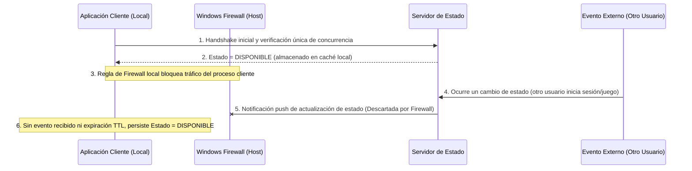

# Estudio de Caso y PoC: Validación de Estado Guiada por Eventos y Launcher en C++/WinAPI

[]()
[]()
[]()
[]()

Estudio técnico de arquitectura de software y prueba de concepto (PoC) en entorno local sobre **desincronización de estado guiada por eventos (*Event-Driven State Desynchronization*, CWE-840 / CWE-602)** analizada sobre el **antiguo sistema retirado de *Steam Family Sharing***, junto con un lanzador de aplicaciones en **C++, Qt y WinAPI** que demuestra la interacción programática con el Firewall de Windows.

---

## Aviso Legal, Ético y de Alcance Académico (*Disclaimer*)

> **Investigación Ética y Educativa (*White-Hat / Academic Case Study*):**
> 1. **Sistema histórico retirado:** Este repositorio documenta exclusivamente un caso de estudio arquitectónico sobre el **antiguo modelo de *Steam Family Sharing*** (sistema sustituido oficialmente por Valve en 2024 por el nuevo modelo *Steam Families*).
> 2. **Sin modificación de software ni evasión de DRM:** Ni el script ni la aplicación en C++ modifican ejecutables, no inyectan código en memoria, no alteran archivos de licencia ni interactúan de forma anómala con servidores externos. El proyecto se limita a gestionar reglas estándar del **Firewall de Windows** en el propio equipo local del usuario para analizar cómo responde una aplicación cliente ante la interrupción de notificaciones *push* de red.
> 3. **Uso responsable:** Todo el material se publica únicamente con fines didácticos, de diseño de protocolos seguros y de portfolio académico en Ingeniería Informática. El autor no promueve ni respalda el uso de estas técnicas para vulnerar los Términos de Servicio (ToS) o acuerdos de licencia de ninguna plataforma.

---

## 1. Análisis Técnico del Problema Arquitectónico (Cómo funciona)

### Causa raíz: Validación basada en eventos (*Push*) sin expiración de sesión (*Fail-Open*)

En los sistemas distribuidos cliente-servidor que gestionan concurrencia de sesiones (como el antiguo sistema de préstamo de biblioteca), es crítico definir qué ocurre cuando el cliente pierde comunicación con el servidor tras haber obtenido una validación inicial:

1. **Verificación única en el estado inicial:** Al iniciar el cliente, este consultaba una vez el estado de los demás miembros de la biblioteca compartida (*«Disponible / Ningún otro usuario activo»*) y almacenaba dicho estado en su caché local.
2. **Invalidación dependiente de eventos externos (*Event-Driven*):** El cliente **no repetía la verificación de forma periódica** mientras no recibiera un evento externo. La actualización del estado dependía de que el servidor enviase una notificación asíncrona (*push*) al cliente en el momento en que ocurría un cambio (por ejemplo, cuando un amigo iniciaba un juego).
3. **Persistencia del estado anterior ante aislamiento de red:** Si tras la verificación inicial se desactivaba la conectividad del proceso cliente mediante una regla en el firewall local del sistema operativo (`Inbound` + `Outbound`), los paquetes de notificación de cambio de estado eran descartados por el firewall del host. Al no existir un temporizador de expiración de concesión (*lease TTL*) ni una política *fail-closed*, el cliente permanecía indefinidamente en el último estado validado (*Disponible*).



---

## 2. Script Educativo de Aislamiento en Firewall (`poc/steam_state_bypass_poc.ps1`)

En [`poc/steam_state_bypass_poc.ps1`](poc/steam_state_bypass_poc.ps1) se incluye un script estructurado en PowerShell que ilustra cómo gestionar reglas de aislamiento por proceso en Windows Filtering Platform (WFP) mediante el módulo oficial `NetSecurity`:

```powershell
# 1. Crear las reglas Inbound/Outbound de laboratorio (deshabilitadas por defecto)
.\poc\steam_state_bypass_poc.ps1 -Mode Install

# 2. Activar el aislamiento de red para el proceso tras la sincronización inicial
.\poc\steam_state_bypass_poc.ps1 -Mode Isolate

# 3. Consultar si las reglas están activas (ON) o inactivas (OFF)
.\poc\steam_state_bypass_poc.ps1 -Mode Status

# 4. Desactivar las reglas y restaurar la sincronización normal
.\poc\steam_state_bypass_poc.ps1 -Mode Restore

# 5. Limpiar y eliminar las reglas del Firewall de Windows
.\poc\steam_state_bypass_poc.ps1 -Mode Remove
```

---

## 3. Implementación del Launcher en C++, Qt y WinAPI (`launcher/`)

El directorio [`launcher/`](launcher/) contiene la aplicación de escritorio desarrollada en **C++ y Qt** como práctica de programación de sistemas en Windows:

* **Gestión de reglas del Firewall del SO:** Invocación controlada de `Enable-NetFirewallRule` y `Disable-NetFirewallRule` con elevación UAC (`-verb runas`) y lectura del estado activo mediante `Get-NetFirewallRule`.
* **Interacción con la API de Windows (`User32.dll`):** Implementación de atajos globales a nivel de sistema operativo (`RegisterHotKey` con `MOD_CONTROL | MOD_ALT` y `VK_F12`) procesando la cola de mensajes de Windows (`PeekMessage` / `WM_HOTKEY`) en un hilo independiente (`std::thread`).
* **Gestión de procesos en segundo plano:** Interfaz sin bordes integrada en la bandeja del sistema (`QSystemTrayIcon`) y lanzamiento desacoplado de procesos hijos (`QProcess::startDetached`).

---

## 4. Mitigación Arquitectónica y Buenas Prácticas de Ingeniería

Este caso de estudio permite extraer tres lecciones fundamentales de **diseño seguro de software (AppSec)** y **administración de sistemas**:

1. **Concesiones temporales (*Leases*) con *Heartbeat* y política *Fail-Closed* (Mitigación de CWE-602 / CWE-840):**
   En cualquier protocolo donde el servidor imponga una restricción de concurrencia, el estado local del cliente nunca debe considerarse válido de forma indefinida a la espera de un paquete *push*. El servidor debe emitir un *token* o *lease* con un tiempo de expiración corto (TTL) que el cliente deba renovar periódicamente (*heartbeat*); si el cliente no puede contactar con el servidor para renovar el *lease*, debe degradar los permisos de forma segura (*fail-closed*).
2. **Integración nativa mediante API COM (`INetFwPolicy2`) en C++:**
   Desde el punto de vista de calidad de software en Windows, delegar operaciones de configuración en subprocesos de `powershell.exe` introduce sobrecarga y dependencias externas. La vía recomendada por Microsoft para aplicaciones en C++ es consumir directamente las interfaces COM de Windows Firewall (`INetFwPolicy2` e `INetFwRules`).
3. **Auditoría y monitorización defensiva en Windows (Blue Team):**
   Los cambios en las reglas del Firewall de Windows quedan registrados de forma nativa en el visor de eventos de seguridad (`Event ID 4946` al añadir una regla, `Event ID 4947` al modificarla y `Event ID 2004/2005` en `Microsoft-Windows-Windows Firewall With Advanced Security/Operational`), lo que permite a los equipos de administración y SOC auditar cualquier alteración de la política de red del host.

---

## Autor

**Alberto Gabriel Vaduva** — Grado en Ingeniería Informática (UCM)  
[bertolt.dev](https://bertolt.dev) · [LinkedIn](https://www.linkedin.com/in/alberto-gabriel-vaduva)
